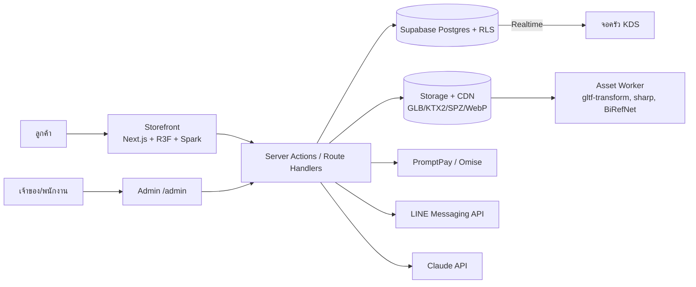

# Virtual Storefront — เอกสารออกแบบ

แพลตฟอร์มร้านค้าออนไลน์ (คาเฟ่ / ร้านอาหาร / ร้านค้าปลีก) ที่ให้ลูกค้า "เดินเข้าร้าน" ผ่านเว็บ หยิบสินค้ามาหมุน ซูม ดูได้รอบทิศ ตั้งค่าร้านเองได้ทั้งหมดจากหลังบ้าน

---

## 1. แนวคิดประสบการณ์ (3 ชั้น)

| ชั้น | ลูกค้าเห็นอะไร | เทคโนโลยี |
|---|---|---|
| **L1 Walk-in** | เปิดประตูเข้าร้าน เดินตามทาง (scroll) หรือกดจุด hotspot ไปโซน เคาน์เตอร์/ตู้/ชั้นวาง | R3F + GSAP ScrollTrigger (camera rail) |
| **L2 Shelf** | สินค้าวางอยู่บนชั้น/เคาน์เตอร์จริง hover แล้วยกขึ้น ป้ายราคาแกว่ง | R3F + drei `<Float>` `<Html>` |
| **L3 Inspect** | หยิบสินค้ามาหมุน 360° ซูมลึกถึงเนื้อสัมผัส เลือกตัวเลือกแล้วเห็นผลทันที วางบนโต๊ะจริงด้วย AR | GLB / Turntable / Splat + `<model-viewer>` (AR) |

### ฉากร้าน (เจ้าของร้านเลือกได้ 3 แบบ)
1. **Template scene** — ฉากสำเร็จรูป (คาเฟ่/ร้านอาหาร/ร้านค้า) ปรับสีผนัง พื้น โลโก้ แสง ได้ → ถูกสุด เร็วสุด
2. **สแกนร้านจริง** — ถ่ายด้วยมือถือ (Scaniverse / Polycam / Luma) → Gaussian Splat `.spz` → render ด้วย **Spark** → สมจริงที่สุด
3. **ภาพ 360°** — พาโนรามาทรงกลม + hotspot → ลงแรงน้อยสุด

### สื่อสินค้า (เลือกต่อสินค้า)
| ชนิด | เหมาะกับ | วิธีได้มา |
|---|---|---|
| `glb` | แก้ว ขวด กล่อง ของชิ้น | Blender / AI image→3D |
| `turntable` | อาหาร เค้ก (สมจริงสุด) | ถ่าย 24–36 ภาพบนจานหมุน → ลบพื้นหลังอัตโนมัติ → ลากหมุน + deep zoom |
| `splat` | จานอาหารพรีเมียม | สแกน Gaussian Splat |
| `photo` | ของทั่วไป | ภาพ hi-res + parallax tilt |

### ลูกเล่นที่ต่างจากร้านทั่วไป
- **Live variant preview** — เลือกไซซ์ แก้วขยายจริง / เพิ่มท็อปปิ้ง mesh โผล่ / เมนูร้อนมีไอน้ำ (particles)
- **แสงตามเวลาจริง** — เปิด/ปิดร้านตามเวลาทำการ ร้านปิด = ไฟหรี่ + ป้าย CLOSED
- **Add-to-cart แบบ 3D** — สินค้าลอยลงถาด/ถุง
- **AI Barista** ที่เคาน์เตอร์ แนะนำเมนูตามรสนิยม
- **คิวสด** — แสดงจำนวนออเดอร์ที่กำลังทำ (Realtime)
- **เสียงบรรยากาศ** (ปิดได้) + Intro เปิดประตู
- **โหมดรายการ 2D** — สั่งเร็ว / มือถือสเปกต่ำ / SEO / Accessibility

---

## 2. สถาปัตยกรรม



| ส่วน | เลือกใช้ | เหตุผล |
|---|---|---|
| Framework | **Next.js (App Router) + TypeScript** | SSR หน้าสินค้า (SEO) + 3D ฝั่ง client |
| 3D | **React Three Fiber + drei + postprocessing** | component-based, ecosystem ใหญ่ |
| Splat | **Spark** (three.js) | render `.spz/.ply` บนมือถือได้ |
| AR | **`<model-viewer>`** | WebXR / Scene Viewer / Quick Look ในตัว |
| Motion | **GSAP ScrollTrigger** (กล้อง) + **Motion** (UI) | |
| UI | **Tailwind + shadcn/ui** | ธีมผ่าน CSS variables ต่อร้าน |
| State | **Zustand** (cart, scene) + **TanStack Query** | |
| Backend | **Supabase** (Postgres, Auth, Storage, Realtime, Edge Functions) | ครบในที่เดียว, มี MCP ใช้งานได้ |
| ORM | **Drizzle** — dev ใช้ **PGlite** (Postgres ใน process ไม่ต้องติดตั้ง) | schema เดียวใช้ได้ทั้ง dev/prod |
| ชำระเงิน | **PromptPay QR** + **Omise/2C2P** (บัตร) | ตลาดไทย |
| แจ้งเตือน | **LINE Messaging API** | LINE Notify ปิดบริการแล้ว (มี.ค. 2025) |
| Hosting | Vercel + Supabase | |

**Multi-tenant:** ร้านละ `slug` / subdomain, ธีมและฉากเก็บใน `jsonb` → ร้านใหม่ไม่ต้องแก้โค้ด

---

## 3. Data Model (สินค้าย่อย)

```
shops            id, slug, type(cafe|restaurant|retail), theme jsonb, scene jsonb, hours jsonb, features jsonb
branches         id, shop_id, name, address, hours jsonb               -- หลายสาขา
categories       id, shop_id, parent_id, name, sort, available_hours    -- เมนูเช้า/เย็น
products         id, shop_id, category_id, name, desc, base_price, status, media jsonb[]
                 -- media: {type: glb|turntable|splat|photo, url, frames[], poster}
product_variants id, product_id, sku, name, price, stock, visual jsonb
                 -- ร้อน/เย็น/ปั่น, S/M/L ; visual: {scale, materials{}, showNodes[], hideNodes[]}
option_groups    id, shop_id, name, min, max, required              -- "ความหวาน", "ท็อปปิ้ง"
options          id, group_id, name, price_delta, visual jsonb, stock
product_option_groups  product_id, group_id, sort
combos / combo_items                                                   -- เซ็ตเมนู
branch_prices    branch_id, variant_id, price, is_available          -- ราคา/ของหมดต่อสาขา
stock_movements  id, variant_id|option_id, qty, reason, ref
scene_hotspots   id, shop_id, zone, position vec3, rotation, target(product|category)
tables           id, branch_id, code, qr_token                         -- สั่งจากโต๊ะ
orders           id, shop_id, branch_id, channel(dine_in|takeaway|delivery), table_id, status, total, paid_at
order_items      id, order_id, variant_id, qty, unit_price, options_snapshot jsonb, note
customers / memberships / points_ledger / coupons
staff            id, shop_id, user_id, role(owner|manager|cashier|kitchen)
audit_logs
```

กฎ: ราคาใน `order_items` เป็น snapshot เสมอ, RLS ทุกตารางกรองด้วย `shop_id`

---

## 4. ระบบหลังบ้าน

| โมดูล | ฟังก์ชัน |
|---|---|
| Dashboard | ยอดขายวันนี้, เมนูขายดี, ออเดอร์สด, ชั่วโมงพีค |
| Catalog | หมวด, สินค้า, variants, option groups, combos, นำเข้า CSV, **อ่านรูปเมนูด้วย AI** |
| Media Studio | อัปโหลด GLB / ภาพ turntable / splat → บีบอัดอัตโนมัติ → พรีวิว 3D, ตั้งมุมกล้องเริ่มต้น |
| Scene Editor | ลากวางสินค้าบนชั้นในฉาก 3D (TransformControls), วาดเส้นทางเดิน, ตั้ง hotspot |
| Orders + KDS | รับออเดอร์ Realtime, จอครัว, เปลี่ยนสถานะ, พิมพ์ใบเสร็จ |
| Inventory | สต็อกต่อ variant/option, แจ้งเตือนใกล้หมด, ปิดขายอัตโนมัติ |
| Marketing | คูปอง, โปรโมชัน, สมาชิก/แต้ม |
| Store Settings | เลือกประเภทร้าน (preset), ธีมสี/ฟอนต์/โลโก้, เวลาเปิด, ช่องทางชำระ, QR โต๊ะ |
| Staff & Roles | สิทธิ์ตามบทบาท, audit log |

**Preset ตามประเภทร้าน:** คาเฟ่ (ความหวาน, น้ำแข็ง, ร้อน/เย็น/ปั่น), ร้านอาหาร (ความเผ็ด, พิเศษ, ไข่ดาว), ร้านค้า (สี, ไซซ์)

---

## 5. Performance Budget

| รายการ | เป้า |
|---|---|
| GLB ต่อสินค้า | ≤ 2 MB (Meshopt/Draco + KTX2) |
| Splat ร้าน | ≤ 15 MB, โหลดแบบ progressive |
| Turntable | 36 เฟรม WebP ~ 40 KB/เฟรม, hi-res โหลดเมื่อซูม |
| LCP หน้าแรก | < 2.5 s (โหลด 2D ก่อน 3D ตามมา) |
| FPS มือถือกลาง | ≥ 45 (`PerformanceMonitor` ลด DPR/effects อัตโนมัติ) |

หลักการ: `frameloop="demand"`, lazy-load ตามโซน, `prefers-reduced-motion` → โหมด 2D, ข้อมูล SEO แบบ schema.org `Menu`/`Product`

---

## 6. การเลือก Model

### ระหว่างพัฒนา (Claude Code)
| งาน | Model | effort |
|---|---|---|
| สถาปัตยกรรม, data model, shader/3D ยาก, code review, security | **Opus 5.5** | high |
| เขียนฟีเจอร์, UI, Admin CRUD, test | **Sonnet 5.5** | medium |
| seed data, แปลภาษา, rename, งานซ้ำๆ (subagent) | **Haiku 5.5** | low |

### ในระบบจริง (Claude API)
| ฟีเจอร์ | Model | ราคา in/out ต่อ 1M token | หมายเหตุ |
|---|---|---|---|
| AI Barista / แนะนำเมนู | `claude-haiku-5-5` | $0.10 / $0.50 | prompt caching เมนูร้าน, streaming |
| เขียนคำบรรยายเมนู / แปล TH-EN-ZH | `claude-haiku-5-5` | $0.10 / $0.50 | Batch API ลด 50% |
| อ่านรูปเมนู/ป้ายราคา → นำเข้าสินค้า | `claude-sonnet-5-5` | $2 / $10 | vision + structured outputs |
| สรุปยอดขาย + แนะนำโปรฯ รายสัปดาห์ | `claude-sonnet-5-5` | $2 / $10 | |

### งาน 3D / ภาพ (ไม่ใช่ Claude)
| งาน | ตัวเลือก |
|---|---|
| ภาพ → โมเดล 3D | Hunyuan3D-2 / TRELLIS (open-source, ต้องมี GPU) หรือ Meshy / Tripo (API) |
| สแกนร้าน / จานอาหาร | Gaussian Splatting: Scaniverse (ฟรี), Polycam, Luma |
| ลบพื้นหลัง turntable | BiRefNet / rembg |
| บีบอัด 3D | `gltf-transform` (meshopt, ktx2, simplify) |

---

## 7. Skills ที่ใช้

**มีในระบบ:** `engineering:system-design`, `design:design-critique`, `design:accessibility-review`, `design:ux-copy`, `figma:figma-3d-transforms`, `claude-api` (AI Barista), `code-review`, `security-review`, `engineering:testing-strategy`, Supabase MCP, Prisma MCP

**จาก GitHub** — [freshtechbro/claudedesignskills](https://github.com/freshtechbro/claudedesignskills) (MIT):
`react-three-fiber`, `web3d-integration-patterns`, `gsap-scrolltrigger`, `motion-framer`, `blender-web-pipeline`
และ [supabase/agent-skills](https://supabase.com/docs/guides/getting-started/ai-skills) — วิธีติดตั้งดูใน `CLAUDE.md`

---

## 8. Roadmap

| เฟส | ส่งมอบ |
|---|---|
| **P0 Foundation** ✅ | Next.js + Supabase, Auth, multi-tenant, Catalog + variants/options, หน้าร้าน 2D, ตะกร้า, PromptPay |
| **P1 3D Inspect** ✅ (เหลือ asset worker) | ตัวดูสินค้า GLB/turntable, live variant preview, Media Studio + asset worker |
| **P2 Walk-in** ✅ (เหลือ splat + ลากวางใน 3D) | ฉาก template 3 แบบ, camera rail, hotspots, Scene Editor, รองรับ splat |
| **P3 Operations** ✅ | ออเดอร์ Realtime, KDS, QR โต๊ะ, LINE แจ้งเตือน, สต็อก |
| **P4 Growth** ✅ (เหลือ Analytics) | AI Barista, อ่านรูปเมนู, สมาชิก/คูปอง, AR, Analytics |
